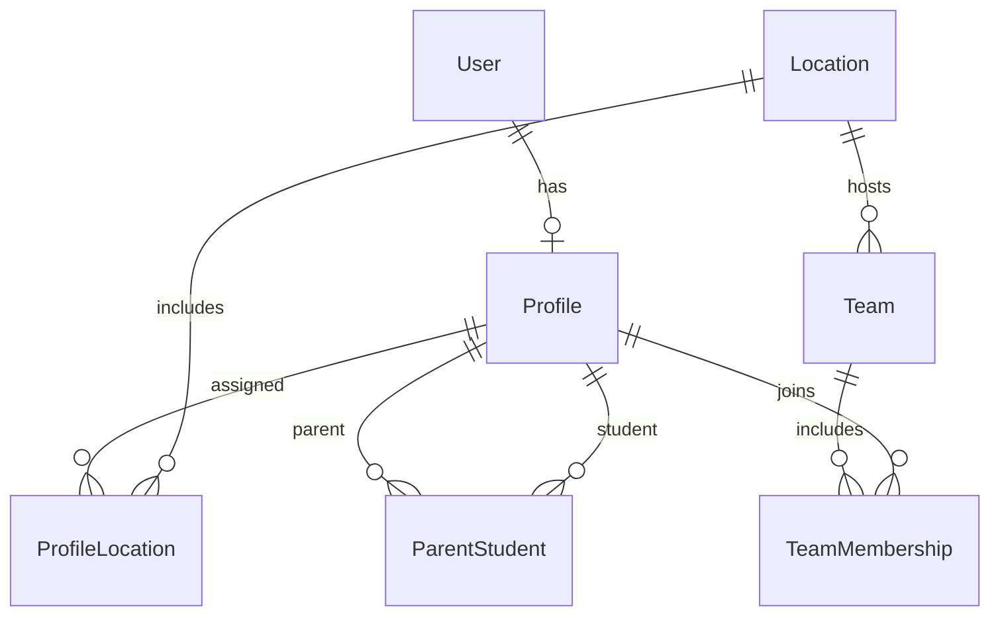

# Ogenesis access proposal

Status: revised draft for review. Implementation follows approval of the schema and flow.

## Scope and decisions

Keep the existing Better Auth authentication, add one profile per user, provide three login pages, and redirect users to the dashboard for their stored role.

Confirmed: each user has one role, access assignments belong to academy locations, and feature settings are deferred until actual features are defined. Country and city describe where a location is; they do not grant access. Email verification is not part of signup or login. Students select their location during signup. Parent signup links to an existing student using that student's link code.

Include the team schema now: every team belongs to one location, and both students and coaches can belong to multiple teams. Team-management workflows and messaging remain deferred.

## Recommended model

Add six tables alongside the existing authentication tables:

| Model                   | Responsibility                                                                                                                                           |
| ----------------------- | -------------------------------------------------------------------------------------------------------------------------------------------------------- |
| `User` (existing)       | Better Auth identity: name, unique email, image, and authentication relationships.                                                                       |
| `Profile` (new)         | One role, contact phone number, location assignments, and parent/student relationships for a user. Student profiles can hold an expiring link-code hash. |
| `Location` (new)        | An academy branch, identified independently of its name, address, city, and country.                                                                     |
| `ProfileLocation` (new) | An explicit assignment connecting a profile to a location.                                                                                               |
| `ParentStudent` (new)   | A many-to-many link between a parent profile and a student profile.                                                                                      |
| `Team` (new)            | A named training group belonging to one location.                                                                                                        |
| `TeamMembership` (new)  | A many-to-many assignment connecting a student or coach profile to a team.                                                                               |



`Profile.userId` is both its primary key and a foreign key to `User.id`, allowing at most one profile per user. Every completed user has one profile; an authenticated user without a profile must complete setup before entering a dashboard.

Keep email and name on `User`. Use `Profile.phoneNumber` for an optional contact number, without a uniqueness requirement or phone-login behavior. The five roles are an enum: `STUDENT`, `PARENT`, `COACH`, `ADMIN`, and `SUPERUSER`. A small server-side mapping controls portal access; editable role and permission tables are unnecessary for this slice.

`Location` has an ID, name, city, and two-letter country code. Multiple locations can share a city or country. `ProfileLocation` uses the profile's user ID and the location ID as its composite primary key, preventing duplicate assignments. Deleting a user removes their profile and assignments; a location with profile assignments or teams cannot be deleted.

`ParentStudent` references `Profile` twice: `parentId` must identify a `PARENT`, and `studentId` must identify a `STUDENT`. Its composite primary key prevents duplicate links while allowing multiple students per parent and multiple parents per student. The server checks roles and rejects self-links; ordinary foreign keys cannot enforce role values across these references. There are no separate parent-profile or student-profile models.

Separate student and parent logins are confirmed for this version. Every student has their own `User` and `Profile`, with an email different from each parent's and sibling's email. A parent helping a child register completes a Student registration, saves the code, signs out of the student's session, and returns to the same form for their own Parent registration. One user's profile is never overwritten or switched from student to parent.

The standalone [Prisma prototype](../packages/db/prototypes/ogenesis-access.prisma) contains the existing auth models plus these additions. It is outside the app's configured schema directory. The previous `Country` and `ProfileCountry` proposal is replaced by `Location` and `ProfileLocation`; no separate country table is needed for this scope.

## Assignment and access rules

- A profile can have several explicitly assigned locations. Proposed initial policy: students, parents, coaches, and admins stay within one country; superusers can span countries. Multiple branches within the same country do not require a superuser role.
- The user's one role applies across all assigned locations. Different roles at different locations would require a later modeling change.
- A role alone grants no location assignments, including for superusers. An empty assignment list denies dashboard access and shows a setup-required message.
- The server validates assignment counts and country restrictions inside trusted provisioning and parent-linking transactions. These are application rules; the database enforces valid references and unique assignments. Location country codes are validated and normalized to uppercase ISO two-letter codes.
- Treat a location's country as fixed while assignments exist, so a metadata change cannot silently bypass the country policy.
- The selected location can live in the dashboard URL, such as `?locationId=...`. Default to the first assigned location ordered by ID. On every protected request, validate the requested location against the current assignments. Reject unassigned location IDs.
- Country and city can group or filter a location selector, but neither expands access. A coach assigned to one Lagos branch cannot access another Lagos branch without another assignment.

Location access does not grant access to all people or records at that location. Parent access to a student requires an explicit parent–student link as well as the applicable location checks. Shared team membership establishes a coach/student relationship; feature-specific access and record-ownership rules will be defined when those workflows are built.

## Teams

`Team` has an ID, name, location ID, and timestamps. Its required `locationId` places it in exactly one academy location. `TeamMembership` connects a team to an existing `Profile`, using `(teamId, userId)` as its composite primary key. This supports any number of students and coaches per team and multiple teams per student or coach, without duplicate membership rows.

Use the same membership table for students and coaches. The profile's existing `role` identifies the member as `STUDENT` or `COACH`; no second team-role field or separate coach/student assignment tables are needed. Parents connect through `ParentStudent` to their children's memberships, rather than becoming team members themselves.

When team-management operations are implemented, the server must accept only `STUDENT` and `COACH` profiles and require an existing `ProfileLocation` assignment for the team's location. Joining a team does not automatically grant access to a new location. Foreign keys enforce the team/profile references, while the role and location rules belong in the server action. Role changes and location-assignment removal must preserve those rules or remove the affected team memberships in the same transaction. A team's location stays fixed while it has members.

For example, one student and one coach can each belong to both an under-14 team and a skills-training team at their assigned location. Another student on either team is connected through that shared membership; the first student's parents are connected through their parent–student links. These relationships provide a basis for future roster or messaging features. Visibility and messaging permissions will be defined with those features.

Deleting a team removes its membership rows without deleting profiles. Deleting a profile removes its memberships without deleting teams. This draft adds the models and relationships only; team creation, assignment screens, and messaging are outside the current workflow scope.

## Location-specific features later

Feature settings are deliberately deferred, as confirmed during review. This prototype has no feature list, feature table, or feature-management screen.

When actual features are defined, enable each feature for the locations where it is offered. A protected feature will require all three conditions: the user's role permits it, the user is assigned to the selected location, and that location offers the feature. Any record-ownership checks also apply. Do not combine enabled features across all assigned locations: a feature offered at one branch does not become available while viewing another branch.

For example, two branches in the same country could eventually offer different gym or training features. Their users still share the same authentication system and role definitions. The appropriate feature-storage model can be chosen once those features are known.

## Login and setup flow

| Login page     | Audience             | Dashboard          |
| -------------- | -------------------- | ------------------ |
| `/login`       | `STUDENT`, `PARENT`  | `/dashboard`       |
| `/login/coach` | `COACH`              | `/dashboard/coach` |
| `/login/admin` | `ADMIN`, `SUPERUSER` | `/dashboard/admin` |

All pages share Better Auth, credentials, and sessions. After login, `/dashboard` reads the authenticated user and their current database profile, resolves an assigned location, and redirects to the dashboard for their stored role. Entering through another portal's login page does not change the user's role. The family and admin portals can render different content for the roles they share.

Each dashboard and protected server action/API uses one shared server helper to enforce its allowed roles and current location assignments. A direct request to another role's dashboard redirects to the correct dashboard; an unauthorized action/API returns a forbidden response. Unauthenticated requests go to the relevant login page. Signed-in users visiting a login page go through the dashboard resolver. There is no automatic role hierarchy granting superusers the parent or coach portal.

Use one public registration form containing name, email, password, Student/Parent selection, a required operating-location selector, and an optional contact phone number. Selecting Parent reveals a link-code field for an existing student. Student signup creates the student first and provides a link code; parent signup is a separate registration. Do not combine child and parent registration into a single submission.

Treat the link code as required for the first child during parent signup. A parent without a code is directed to register the student first, obtain the student's code, and then return to register as a parent. Additional children are linked later from the parent's dashboard using their own codes. Different parents can link to the same student.

Validate the form on the server and create the Better Auth account. Then create the profile, selected-location assignment, and any parent–student link together in a Prisma transaction using the authenticated user ID. The registration form collects these details upfront; successful signup goes directly through `/dashboard`, without a separate normal onboarding form. Retain `/onboarding` only as recovery for an existing auth user whose profile setup is incomplete. Failed setup can be retried without granting dashboard access or creating another auth account.

Public registration and recovery accept only `PARENT` or `STUDENT` and a valid operating location. Reject existing profiles and staff roles; never silently default all existing users to student. A failed or missing parent link must not silently produce a completed parent profile. Users can sign in and complete setup without verifying their email; there is no verification email, verification screen, or verification-based access restriction.

Retain Better Auth's existing `emailVerified` field and `Verification` model for compatibility with the authentication system. Leaving `emailVerified` false must not block access, and the application must not mark an unverified email as verified just to permit login.

## Parent–student links and link codes

Keep one active link code per student to avoid a separate code-management table. Store only `parentLinkCodeHash` and `parentLinkCodeExpiresAt` on the student's profile; both fields are empty on other profile types. Generate a cryptographically random code with at least 128 bits of randomness and a seven-day lifetime, return the raw code only when generated, and allow the student to generate a replacement from their dashboard. Replacing a code invalidates the old code without removing established parent links. The code can be used by multiple parents until it expires or is replaced.

The code is an access credential for establishing a relationship, not a referral discount or a login password. Rate-limit attempts, avoid logging raw codes, and use a common invalid/expired-code response without exposing student details. A student can share the code outside the app; no email-verification or invitation-email workflow is introduced.

On parent signup, the selected location must be one of the student's assigned locations. Validate the code before creating the auth account to catch ordinary form errors, and recheck its hash, expiry, student role, and location when committing the profile/link transaction. If the code becomes invalid in between, leave the auth user in recoverable incomplete setup rather than creating an unlinked parent. Derive the student ID from the code on the server; do not trust a submitted student ID or parent ID.

From the parent dashboard, an authenticated parent can link another existing student using a valid code and a selected location assigned to that student. The server uses the current parent's ID and creates the `ParentStudent` row. If the parent does not already have that location, add that specific location assignment in the same transaction, subject to the existing single-country policy. This is a narrow exception to staff-managed location changes: a code does not copy all of a student's locations or bypass country restrictions. Repeating an established link is harmless and creates no duplicate row.

For a selected location, parent access to a student requires the parent–student relationship and location assignments for both people. Linking a student never grants access to unrelated students at that branch. Deleting either profile removes its relationship rows, without deleting the other person's account. Trusted role changes must reject a change away from `PARENT` or `STUDENT` while incompatible relationship rows remain, and non-student profiles must not retain active link codes.

## Who can create accounts

| New account role | Allowed creator                                                                     |
| ---------------- | ----------------------------------------------------------------------------------- |
| `STUDENT`        | The student through public signup.                                                  |
| `PARENT`         | The parent through public signup.                                                   |
| `COACH`          | An authenticated `ADMIN` or `SUPERUSER`.                                            |
| `ADMIN`          | An authenticated `SUPERUSER` only.                                                  |
| `SUPERUSER`      | The server-side bootstrap script only; no public or staff-facing creation endpoint. |

Students and parents register through the same form in separate submissions. A parent signs up with their own email and password and links to an already registered student.

Implement staff creation through protected server actions, with small forms in the admin portal. Check the creator's current database role on the server, use an explicit allowlist of target roles, and reject crafted requests for a higher role. Public Better Auth signup and onboarding cannot create a staff profile. An admin cannot create another admin or a superuser. A coach cannot create staff accounts. Creating an account must leave the creator signed in as themselves.

Staff creation includes the new user's email, name, initial password, role, and location assignments. Store credentials through Better Auth's account/password handling; never save a plaintext password in a profile. Assign only locations the creator currently has access to, and enforce the existing country policy for the new profile. Passwords work immediately without an email-verification step. Invitations, onboarding emails, and password-delivery workflows are outside this slice.

Use the same authorization rules for later role changes so an unrestricted profile update cannot bypass account-creation restrictions. Existing staff classification and location changes outside the parent-linking flow use trusted server-side provisioning. A profile with missing assignments gets a setup-required message; public onboarding cannot repair staff access. An auth user may temporarily exist without a profile, but a completed user must have one profile and at least one assignment.

## Superuser bootstrap and local testing

Add a small server-side bootstrap script during implementation. It accepts an email, password, name, and explicit location IDs, creates the Better Auth credential account, and assigns a `SUPERUSER` profile and those locations. Being a superuser does not automatically assign every location. No separate username field or username-login plugin is needed: the login identifier is an email address.

The script will support an explicit local mode with these development defaults:

| Field    | Local value               |
| -------- | ------------------------- |
| Name     | Local Superuser           |
| Email    | `superuser@ogenesis.test` |
| Password | `OgenesisLocal!2026`      |

Local defaults are allowed only against a local database in development or test mode. Other runs require explicitly supplied credentials and locations. The script uses Better Auth's password handling, does not log supplied secrets, and can be rerun without silently resetting an existing password or promoting an unrelated account. If the email already belongs to a different role or an account without a profile, it reports the conflict instead of elevating it. No account is created by this review draft.

## Implementation after approval

1. Add `Role`, the six models, and the `User.profile` relation to the real schema. Review an additive migration, regenerate the client, seed operating locations, and add the superuser bootstrap script with explicit local defaults. Include `Team` and `TeamMembership` in the schema without introducing team-management screens.
2. Add the single parent/student registration form with location selection and the conditional parent link-code field. Add link-code generation and the protected additional-child linking action. Keep `/onboarding` for incomplete-setup recovery, and share the role/location access helper across flows. Keep email verification disabled.
3. Add the three login pages, the `/dashboard` resolver, three guarded dashboard shells, and a location selector for users with multiple assignments. Add minimal protected staff-creation forms: coaches for admins and superusers, admins for superusers.
4. Verify all five roles, signup location selection, student-first/parent-second registration, separate accounts, multiple parents and children, invalid/expired/replaced codes, duplicate-link retries, location mismatches, and incomplete-setup recovery. Also verify signup without email verification, the staff-creation allowlist, preservation of the creator's session, bootstrap reruns, direct dashboard/API access, unassigned-location rejection, and access changes during an existing session. Validate the team schema's location relationship, multiple memberships, duplicate prevention, and deletion behavior.

Defer feature configuration, custom permissions, multiple roles, separate country/city models, enrollment, payments, training workflows, team-management workflows, and messaging. Parent–student links and the signup link-code workflow are included in this slice; teams are included as database models only.

## Prototype validation

With dependencies installed, run from the repository root:

```sh
./packages/db/node_modules/.bin/prisma validate --schema packages/db/prototypes/ogenesis-access.prisma
```

This checks schema syntax and relations without connecting to a database. It does not verify application access rules. This review draft does not apply a migration or change authentication behavior.
